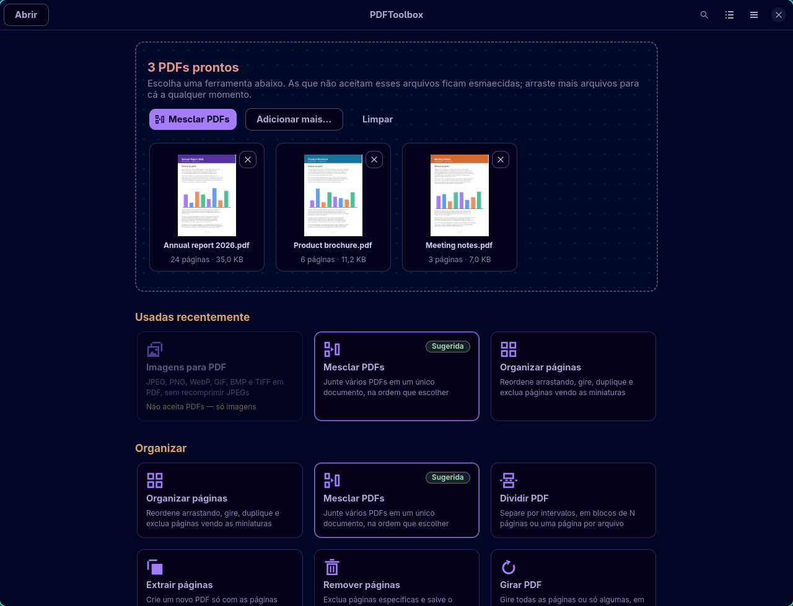
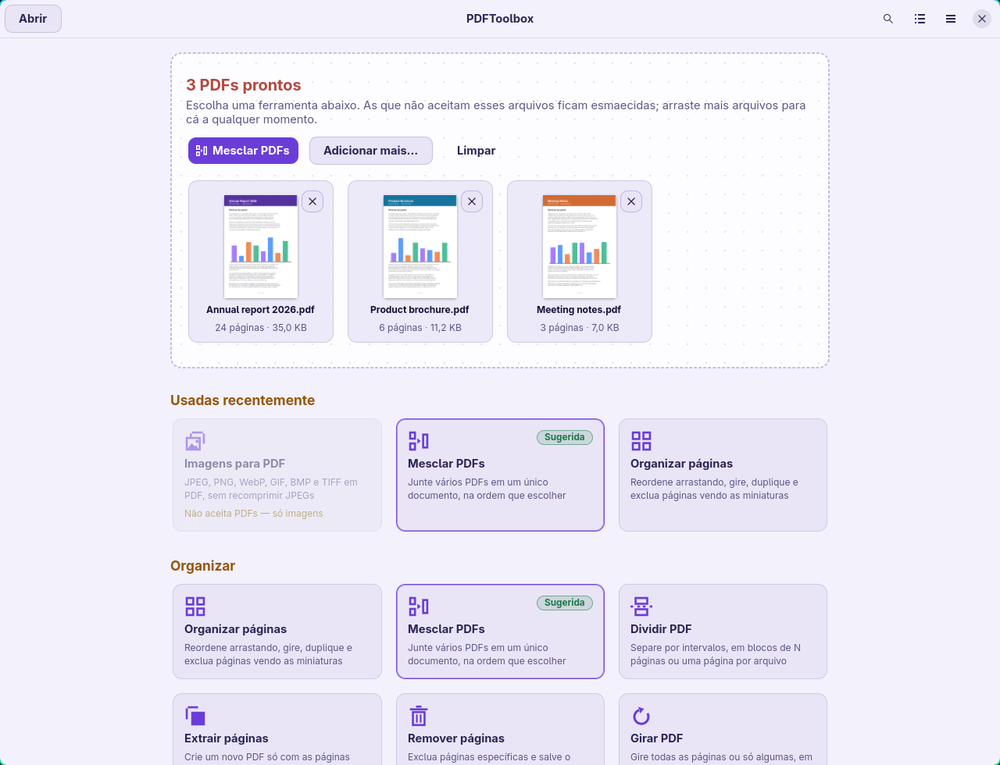
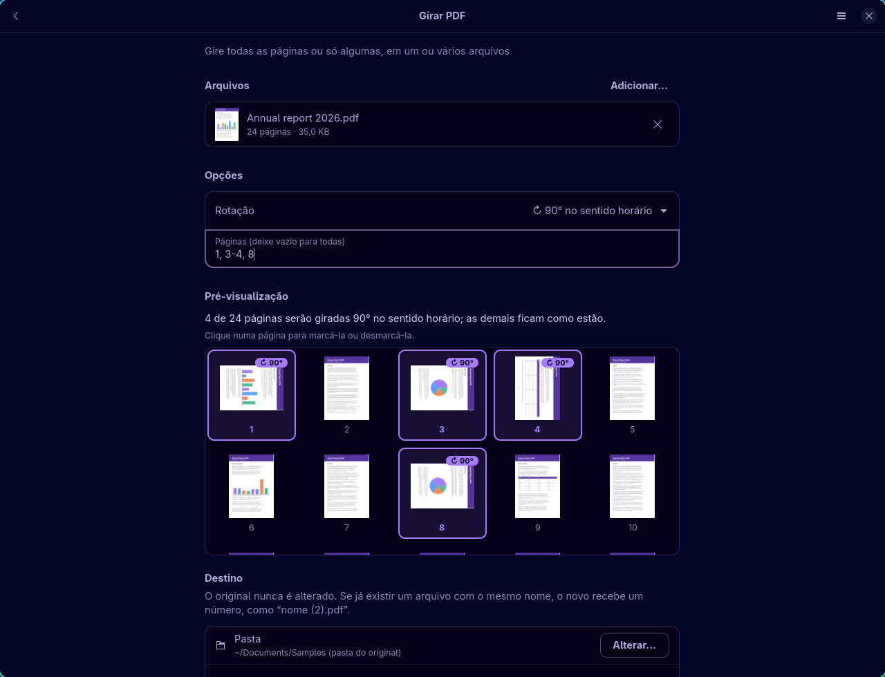
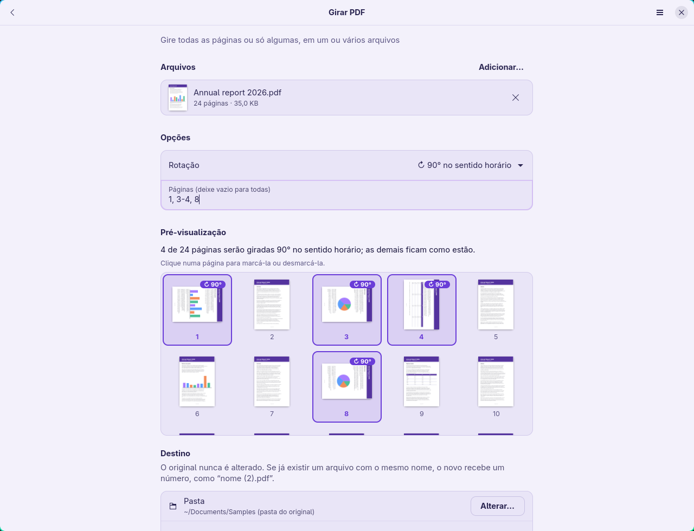
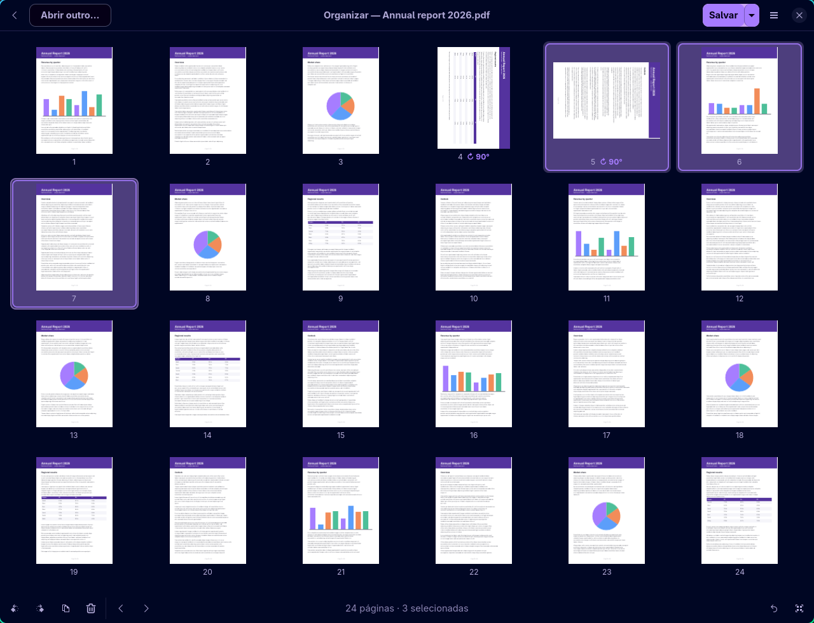
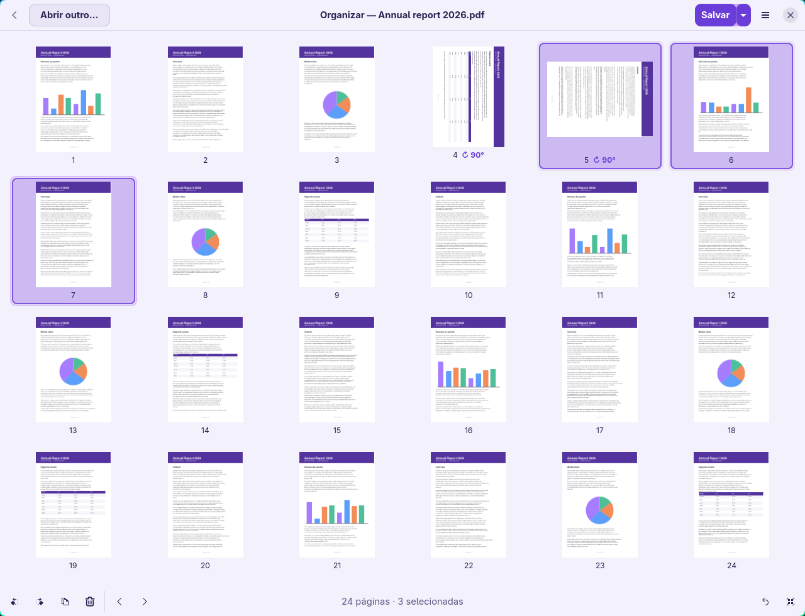
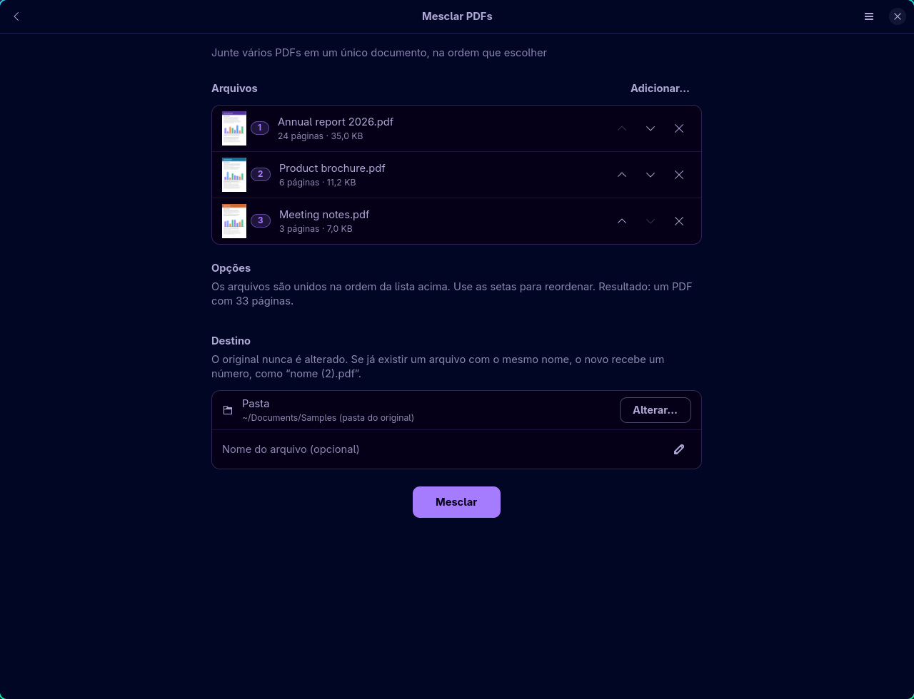
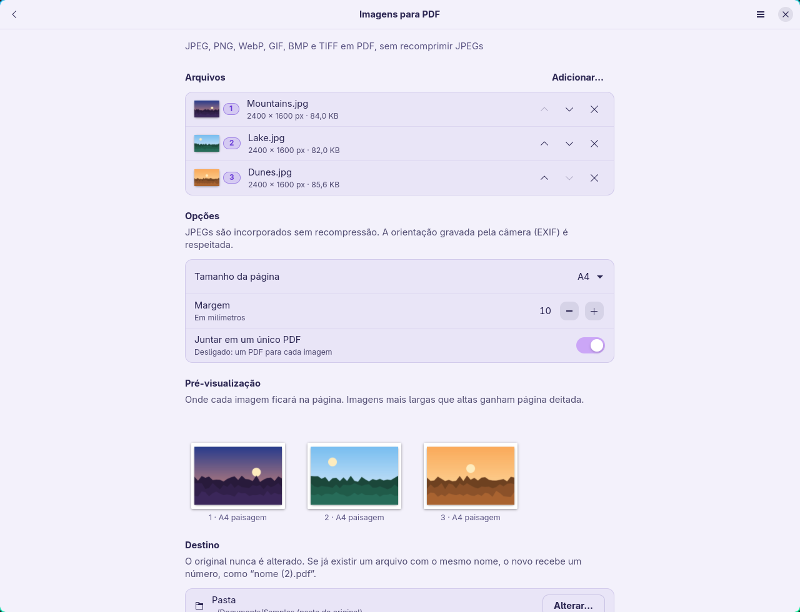

# PDFToolbox

**Everyday PDF tools for Linux that run entirely on your computer.**

Merge, split, organize, rotate, convert and compress PDFs in a native desktop
app (Rust + GTK4/libadwaita). Your files never leave your machine.

- 🔒 **100% local.** Every operation runs on your computer. Nothing is uploaded, ever.
- 📵 **No internet access.** The app makes no network connections: no update checks, no remote fonts, no "cloud" features.
- 🙈 **No data collection.** No telemetry, no analytics, no crash reports sent anywhere.
- 💸 **No subscription, no account, no ads.** Free and open source (GPL-3.0-or-later).
- 🛡️ **Your originals are safe.** Source files are never modified or overwritten.

> **Language note:** the user interface is currently in **Brazilian Portuguese**
> only. This README is in English; the other project documents
> ([ARCHITECTURE](ARCHITECTURE.md), [SECURITY](SECURITY.md),
> [CHANGELOG](CHANGELOG.md), …) are in Portuguese.

## Screenshots

The app follows your system's light/dark preference (or you can pick one in
the menu). The screenshots below use made-up sample documents.

### Home: drop files, see what you picked, get a suggested tool

| Dark | Light |
|---|---|
|  |  |

Each file appears as a card with its first page, page count and size. Tools
that can't handle the selected files are dimmed and say why.

### Rotate: live preview of exactly which pages will turn

| Dark | Light |
|---|---|
|  |  |

Type a page range or click the thumbnails. The preview shows the pages
actually rotated before you save. Extract, Remove and Split have the same
kind of preview.

### Organize pages: reorder, rotate, duplicate and delete visually

| Dark | Light |
|---|---|
|  |  |

### Merge PDFs and convert images to PDF

| Dark | Light |
|---|---|
|  |  |
|  |  |

## Features

| Tool | What it does |
|---|---|
| **Organize pages** | Thumbnails, multi-select, drag to reorder, rotate, duplicate, delete, undo, keyboard shortcuts |
| **Merge PDFs** | Combine files in any order; the same file can be added more than once |
| **Split PDF** | By ranges (`1-3, 4-8, 9-`), every N pages, or one file per page |
| **Extract pages** | Into one PDF (in the order you type) or one file per page |
| **Remove pages** | Delete specific pages and keep the rest |
| **Rotate PDF** | All pages or just some, across several files at once |
| **Images to PDF** | JPEG, PNG, WebP, GIF, BMP, TIFF; A4 / Letter / image size; margins; JPEGs embedded without recompression; EXIF orientation; transparency |
| **PDF to images** | PNG, JPEG (adjustable quality) or TIFF, 36–1200 DPI, in batch |
| **Compress PDF** | Lossless (qpdf) or with image downsampling (Ghostscript); shows the savings and skips the output when there is no gain |

Structural operations (organize, merge, split, extract, remove, rotate) are
done by **qpdf without rasterizing**: searchable text, fonts and vector
graphics are preserved exactly.

The full roadmap (OCR, watermarks, passwords, forms, PDF/A, …) and the status
of every feature are in [FEATURE_MATRIX.md](FEATURE_MATRIX.md).

### How your files are protected

- The original is **never** modified or overwritten. If the output name
  already exists, the new file gets a number: `name (2).pdf`.
- Results are written to a private temporary folder, **verified** (the PDF
  must open and have the expected page count) and only then moved into place
  atomically.
- If something fails or you cancel, nothing is left behind. In batch jobs, one
  bad file doesn't stop the others, and the final report lists what succeeded
  and what failed.
- External tools are called with separate arguments (never through a shell),
  and PDF scripts or attachments are never executed.

Details in [SECURITY.md](SECURITY.md).

## Installation

PDFToolbox is built from source. There are no prebuilt packages yet.

### 1. Install the dependencies

You need a Linux distribution with **GTK ≥ 4.12** and **libadwaita ≥ 1.5**,
plus three command-line PDF tools the app uses under the hood:

| Component | Used for |
|---|---|
| GTK 4 + libadwaita (with development headers) | The user interface |
| qpdf | All page operations |
| Poppler utils (`pdftoppm`, `pdfinfo`) | Thumbnails, previews, PDF → images |
| Ghostscript *(optional)* | Compression with image downsampling |
| A C toolchain + `pkg-config` | Compiling the GTK bindings |

**Arch Linux / Manjaro / EndeavourOS** (tested)

```sh
sudo pacman -S --needed base-devel gtk4 libadwaita qpdf poppler ghostscript
```

**Debian 13+ / Ubuntu 24.04+ / Linux Mint 22+**

```sh
sudo apt install build-essential pkg-config libgtk-4-dev libadwaita-1-dev qpdf poppler-utils ghostscript
```

**Fedora 40+**

```sh
sudo dnf install gcc pkgconf-pkg-config gtk4-devel libadwaita-devel qpdf poppler-utils ghostscript
```

**openSUSE Tumbleweed**

```sh
sudo zypper install gcc pkg-config gtk4-devel libadwaita-devel qpdf poppler-tools ghostscript
```

Older releases (Ubuntu 22.04, Debian 12) ship libadwaita versions that are too
old and are not supported.

### 2. Install Rust

PDFToolbox needs **Rust 1.85 or newer**. The distribution package is often
older, so the official installer is the safest choice:

```sh
curl --proto '=https' --tlsv1.2 -sSf https://sh.rustup.rs | sh
```

Then open a new terminal (or run `source ~/.cargo/env`). On Arch, `sudo pacman
-S rustup && rustup default stable` works too.

### 3. Download, build and run

```sh
git clone https://github.com/Leonardo-Sponton/pdftoolbox.git
cd pdftoolbox
cargo run --release
```

The first build downloads the Rust libraries and takes a few minutes. Later
runs start right away. Downloading only happens at build time: the app itself
never goes online.

### 4. Install it in your applications menu (optional)

```sh
./install.sh
```

This builds the app and installs it **for your user only** in `~/.local`
(no `sudo` needed):

- the `pdftoolbox` command in `~/.local/bin`;
- a menu entry, so **PDFToolbox** shows up with your other apps;
- "Open with PDFToolbox" for PDFs and images in your file manager.

| Task | Command |
|---|---|
| Update | `git pull && ./install.sh` |
| Uninstall | `./install.sh --uninstall` |

Settings are stored in `~/.config/pdftoolbox/` and temporary files in
`~/.cache/pdftoolbox/`. Uninstalling keeps them; delete those folders if you
want a clean slate.

If something is missing, open the menu (☰) → **Dependências**
("Dependencies"). It lists what is installed, the versions found and the
command to install anything missing on your distribution. The app never runs
`sudo` by itself.

## Usage

1. Drag files onto the window, or click **Abrir** ("Open").
2. Pick a tool. The suggested one is highlighted, and tools that can't handle
   your files are dimmed.
3. Check the preview, adjust the options and the destination folder, and
   click the action button (or press **Ctrl+Enter**).

The result is saved next to the original by default. When the job finishes,
you can open the new file or show it in its folder with one click.

### Keyboard shortcuts

| Where | Shortcut | Action |
|---|---|---|
| Everywhere | **Ctrl+O** | Open files |
| | **Ctrl+F** | Search tools |
| | **Ctrl+T** | Tasks panel |
| | **Ctrl+Enter** | Run the current tool |
| | **Alt+←** | Back |
| | **Ctrl+Q** | Quit |
| Previews | **Tab**, arrows, **Enter** | Move between thumbnails and mark/unmark pages |
| Organizer | **Ctrl+R** / **Ctrl+Shift+R** | Rotate right / left |
| | **Ctrl+D** | Duplicate |
| | **Delete** | Delete pages |
| | **Ctrl+←** / **Ctrl+→** | Move pages |
| | **Ctrl+A** | Select all |
| | **Ctrl+Z** | Undo |
| | **Ctrl+S** | Save |

## Privacy you can check

PDFToolbox contains no code that connects to the network. You don't have to
take our word for it, though. On most
distributions you can launch it inside a namespace with no network at all,
and everything keeps working:

```sh
unshare -rn pdftoolbox
```

(A harmless warning about the accessibility bus may appear in the terminal.)

## Performance

Measured with `cargo run --release --example bench` on an Intel Core i5-1334U,
16 GB RAM and an NVMe SSD, using files generated by the benchmark itself:

| Operation | Input | Time |
|---|---|---|
| Merge (2 copies) | 1000-page text PDF, 305 KB | 0.15 s |
| Extract 500 alternating pages | same | 0.13 s |
| Split into 10 files of 100 pages | same | 0.85 s |
| Rotate every page | same | 0.13 s |
| Images → PDF | 20 JPEGs, 2400×1800 | 0.78 s |
| PDF → PNG at 150 DPI | 20 photo pages, 41 MB | 2.15 s |
| Compress, recommended | same | 1.29 s (41 MB → 2.0 MB, −95%) |
| Compress, maximum | same | 1.19 s (41 MB → 563 KB, −99%) |

Times include verifying the result and writing it safely.

## Known limitations

- **Interface in Portuguese only** for now.
- **Linux only.** It has been tested on Arch Linux (GTK 4.24, libadwaita
  1.10, Wayland). The Debian/Ubuntu/Fedora/openSUSE instructions above follow
  those distributions' package names but have not been tested on real
  machines yet. Reports are welcome.
- **Password-protected PDFs** are detected and refused with a clear message.
  Opening them with a password is planned. The app will never try to bypass
  unknown passwords.
- Compression with downsampling rewrites the document with Ghostscript. Check
  the result on PDFs with forms, links or attachments.
- "Images to PDF" with the "same as image" page size assumes 96 DPI.
- Not yet available: OCR, watermarks, password protection, Office → PDF,
  forms and digital signatures. See the [roadmap](FEATURE_MATRIX.md).

## Contributing

Bug reports and ideas are welcome in the issue tracker. Build, test and code
conventions are described in [CONTRIBUTING.md](CONTRIBUTING.md) (in
Portuguese). Quick checks:

```sh
cargo test
cargo clippy --all-targets
cargo fmt --check
```

## License

PDFToolbox is free software, licensed under the
[GNU General Public License v3.0 or later](LICENSE). A review of the licenses
of all dependencies is in [LICENSES.md](LICENSES.md).
